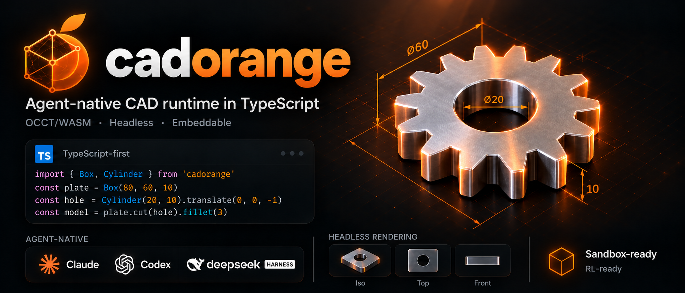

<p align="center">
  
</p>

<h1 align="center">cadorange</h1>

<p align="center">
  <b>面向 AI Agent 的 TypeScript CAD 运行时,基于 occt.ts(OCCT/WASM)。</b><br/>
  无头 · 可嵌入 · 零 Python · 只需 <code>npm i</code>
</p>

<p align="center">
  <a href="https://www.npmjs.com/package/cadorange"></a>
  <a href="https://www.npmjs.com/package/cadorange"></a>
  <a href="./LICENSE"></a>
  <a href="https://github.com/LAU-MARS/cadorange/actions/workflows/ci.yml"></a>
</p>

<p align="center">
  <a href="./README.md">English</a> | 简体中文
</p>

## cadorange 是什么?

cadorange 是一个为 AI Agent 打造的代码式 CAD 内核与运行时。它可以在任何能运行 JavaScript 的地方运行,包括 Node、Bun、Deno、浏览器、Web Worker 和沙箱环境。它为 Agent 提供一个真正的 B-Rep CAD 引擎(OpenCASCADE,经 occt.ts 编译为 WASM),以及 Agent 所需的运行时特性:

- **快照、分叉与回滚。** 每个模型都是一份操作日志,所以你可以尝试修改、检查结果,失败就回滚。
- **结构化错误。** 失败以 JSON 返回,包含失败的 op、原因和建议的修复方式,不需要去解析 OCCT 的调用栈。
- **无头渲染。** 无需 GPU 或浏览器窗口即可输出多视角 PNG/SVG 渲染,让视觉模型可以自查结果。
- **确定性输出。** 相同的代码产生相同的几何体、哈希和渲染,适合用于评测(evals)和强化学习(RL)。
- **可内省。** `describe()` 以纯 JSON 返回体积、包围盒、面数、边数和拓扑摘要。
- **装配体与运动副。** 运行时装配树(`Assembly`)+ build123d 运动副族(刚性/旋转/移动/圆柱/球/平面/极坐标副):`connectTo` 求解零件摆位,`solve()` 按当前关节值重放连接(运动研究),`explode()` 生成爆炸图,整棵树带名称/颜色/实例变换经 STEP 往返。
- **可嵌入。** 进程内运行,不需要 Python、conda、子进程,也不需要服务器。

它可以作为普通库使用,也可以作为 CLI(`cado`)或 MCP 服务器使用。这意味着它可以接入 Claude Code、Codex、dsh 以及任何支持 MCP 的 Agent。

## 快速开始

### 作为库

```bash
npm i cadorange
```

```ts
import { init, Box, Cylinder, Axis, fillet } from "cadorange";

await init(); // 一次性加载 OCCT WASM 内核

const plate = Box(80, 60, 10);
const hole = Cylinder({ radius: 8, height: 10 });

let part = plate.cut(hole);
part = fillet(part.edges().filterBy(Axis.Z), 3);

console.log(part.describe());
// { volume: 45912.12, bbox: [80, 60, 10], faces: 11, edges: 27, valid: true }

await part.export("plate.step");
await part.export("plate.stl", { tolerance: 0.05 });
```

### CadQuery 风格的链式 API

```ts
import { Workplane } from "cadorange/workplane";

const part = new Workplane("XY")
  .box(80, 60, 10)
  .faces(">Z").workplane()
  .hole(16)
  .edges("|Z").fillet(3);
```

### 作为 MCP 服务器

> **状态:规划中(M2)。** 运行时落地后将通过 `npx -y cadorange mcp` 提供;
> 在此之前,下面的命令展示的是目标接入方式。

**Claude Code**

```bash
claude mcp add cadorange -- npx -y cadorange mcp
```

**Codex(`~/.codex/config.toml`)**

```toml
[mcp_servers.cadorange]
command = "npx"
args = ["-y", "cadorange", "mcp"]
```

**dsh**

dsh 内置 cadorange 支持,在 dsh 的设置中把它添加为 MCP 服务器:

```json
{
  "mcpServers": {
    "cadorange": { "command": "npx", "args": ["-y", "cadorange", "mcp"] }
  }
}
```

**任何 MCP 客户端**

```json
{
  "mcpServers": {
    "cadorange": { "command": "npx", "args": ["-y", "cadorange", "mcp"] }
  }
}
```

### 作为 CLI

```bash
npx cado run model.ts --render iso,top,front --export step,stl
npx cado describe model.ts --json
```

### Agent 运行时

> **状态:规划中(M0.5)。** 目前只有接口骨架。

```ts
import { Session } from "cadorange/runtime";

const s = await Session.create({ limits: { timeoutMs: 10_000, memoryMB: 512 } });

const r1 = await s.run(`const p = Box(80, 60, 10); export default p;`);
const base = s.snapshot();               // 低开销:操作日志 + 缓存的形状

const r2 = await s.run(`export default fillet(p.edges(), 40);`);
if (!r2.ok) {
  console.log(r2.error);
  // {
  //   code: "FILLET_RADIUS_TOO_LARGE",
  //   op: { id: 3, type: "fillet", args: { radius: 40 } },
  //   message: "Fillet radius 40 exceeds the max feasible radius (~5) for 12 edges.",
  //   hint: "Try radius <= 4.9, or fillet a subset: p.edges().filterBy(Axis.Z)"
  // }
  s.rollback(base);
}

const views = await s.render({ views: ["iso", "top", "front"], size: 512 }); // PNG 缓冲区
```

| 能力 | API |
| --- | --- |
| 运行代码 / op | `session.run(code)` · `session.apply(op)` |
| 快照 / 分叉 / 回滚 | `snapshot()` · `fork(snap)` · `rollback(snap)` |
| 检查 | `describe()` · `diff(snapA, snapB)` |
| 渲染 | `render({ views, size, format })` |
| 导出 | `export("step" \| "stl" \| "glb" \| "brep")` |
| 限制 | 每个会话的超时、内存和 op 数量限制 |

## 包

单一 npm 包,和 build123d 一样 —— 下面所有内容都是 `cadorange` 的子路径导出:

| 导入 | 说明 | 状态 |
| --- | --- | --- |
| `cadorange` | 核心建模 API:形状、选择器、布尔运算、特征、导入/导出 | [](https://www.npmjs.com/package/cadorange) |
| `cadorange/workplane` | CadQuery 风格的链式门面 | 已发布 |
| `cadorange/runtime` | 会话、操作日志、快照、结构化错误、沙箱执行 | 规划中(M0.5)—— 接口骨架 |
| `cadorange/render` | 无头多视角渲染(PNG/SVG) | 规划中(M2)—— 接口骨架 |
| `cadorange/mcp` + `cado` CLI | MCP 服务器(`npx -y cadorange mcp`)与 `cado` CLI | 规划中(M2)—— 接口骨架 |
| `cadorange/occt` | 受支持的逃生舱:原生 OCCT 类、`toRaw`/`fromRaw`、`shape.wrapped`(类似 build123d ↔ OCP) | 已发布 |

## 为什么用 TypeScript?

- **Agent 零安装。** `npx` 就够了,不需要管理 Python 环境、conda 或 wheel。
- **能在浏览器里跑。** 同一个内核可以驱动 Web CAD 应用、playground 和客户端预览。
- **类型化 API = 更好的 Agent 反馈。** 类型错误在几何体运行之前就会暴露。
- **进程内、可嵌入。** 适配 Node/Bun Agent、VS Code 扩展、Electron 应用和边缘沙箱。

## 与 build123d 和 CadQuery 的关系

cadorange 的灵感来自 [build123d](https://github.com/gumyr/build123d) 和 [CadQuery](https://github.com/CadQuery/cadquery)。我们认为它们是当下最好的代码式 CAD API,LLM 对它们也早已非常熟悉。

- 核心 API 遵循 build123d 的显式对象模型(`Box`、`Cylinder`、`fillet`、`Axis`、`ShapeList.filterBy/groupBy/sortBy`)。Python 的运算符重载(`a - b`)变为方法(`a.cut(b)`)。
- `cadorange/workplane` 提供一层轻量的 CadQuery 风格链式门面,支持字符串选择器(`">Z"`、`"|Z"`)。
- 命名转换为 camelCase(`filter_by` → `filterBy`)。差异详见迁移对照表。
- cadorange 是独立项目,与两者没有任何隶属关系。

## 路线图

- [ ] **M0:可走通的骨架。** 盒体、圆柱、布尔运算、倒角/圆角、基础选择器、操作日志与回滚、STEP/STL 导出、等轴测 PNG 渲染、接入 Claude Code 的 MCP、Node 与浏览器双端可用
- [ ] **M1:草图与特征。** 2D 草图、拉伸、旋转、放样、扫掠、抽壳、孔、阵列
- [ ] **M2:Agent 闭环。** 结构化错误目录、describe/diff、多视角渲染、沙箱限制、CADGenBench 集成
- [ ] **M3:广度。** 覆盖 LLM 最常用的 API(由基准测试结果驱动);Workplane 门面;文档
- [ ] **M4:RL 就绪。** 确定性的 op 级环境、奖励钩子(有效性、体积/IoU、渲染相似度)、批量 rollout

## 开发

```bash
pnpm i
pnpm build
pnpm test           # vitest(node)
pnpm test:browser   # vitest 浏览器模式
```

见 [CONTRIBUTING.md](./CONTRIBUTING.md)。

## 许可证

Apache-2.0。OpenCASCADE Technology 采用 LGPL-2.1(含例外条款)授权。见 [NOTICE](./NOTICE)。
